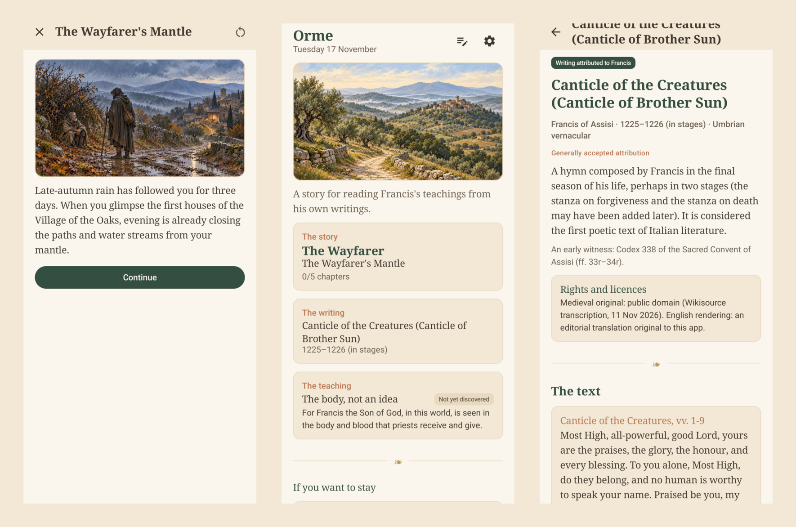
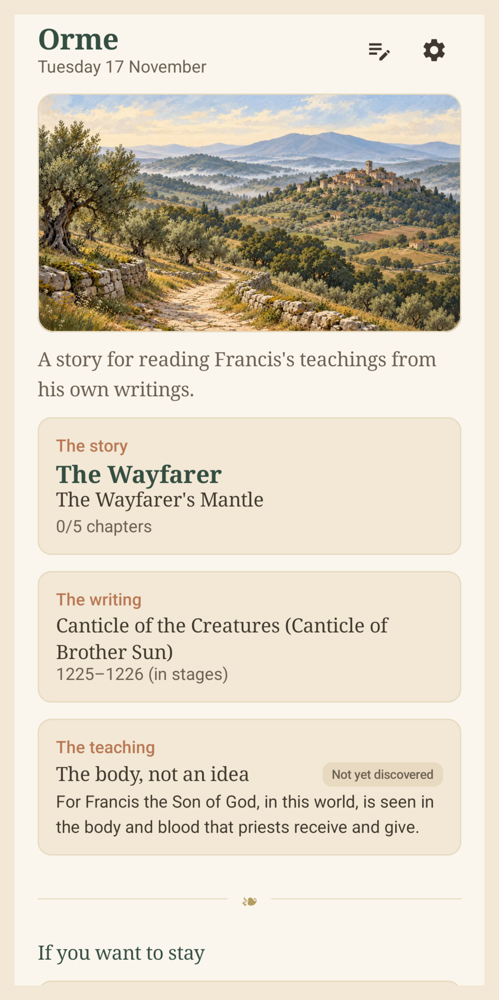
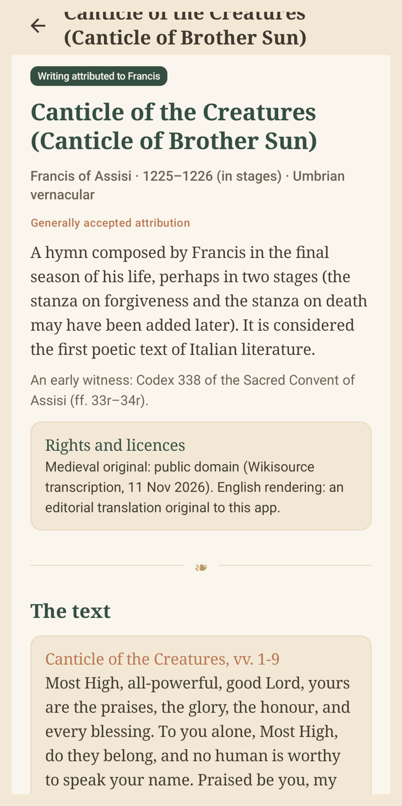
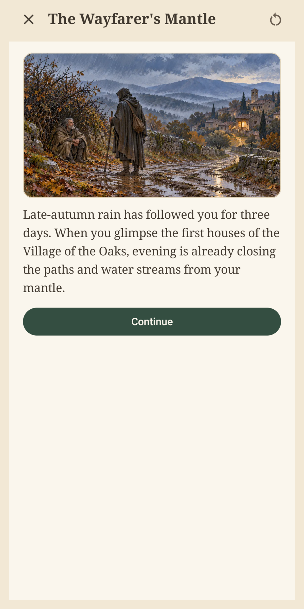
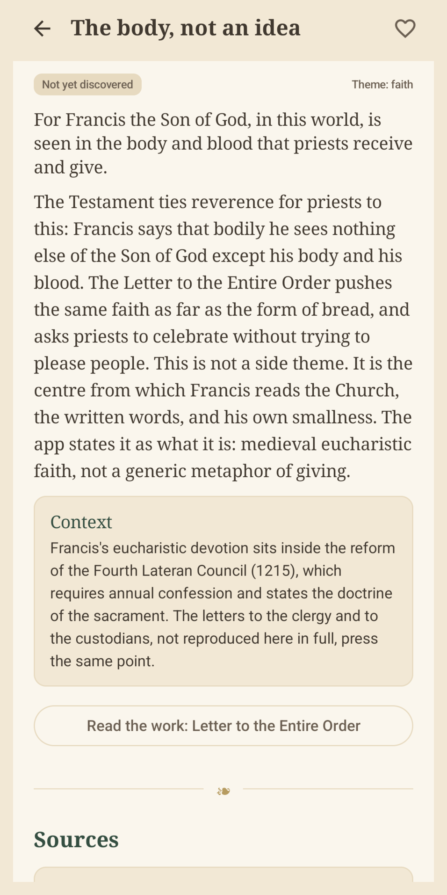
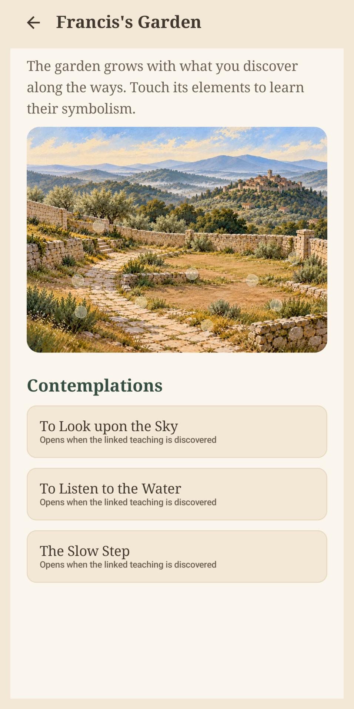

# Orme

Orme is a native Android app for reading the life and teachings of Saint Francis of Assisi. You enter through a story set in early thirteenth-century Umbria. The teachings hang from his writings, and the medieval text stays beside the translation.

The register is adult. The app describes what Francis wrote and how he lived. It does not score the reader, and it does not speak in his voice.



## What you can do

The home is a short path, not a menu of four products.

- **The story.** Five chapters as a wayfarer who is not Francis. Choices stay in a profile on the device. Places and historical panels say what is documented, what is tradition, and what the story invented.
- **The writings.** The Testament, the Earlier Rule, the Later Rule with the bull of Honorius III, the Letter to the Entire Order, and the Canticle of the Creatures can be read through. The original is Latin, or Umbrian for the Canticle. The translation is editorial and original to this app. Shorter works that do not yet have a clean public-domain transcription, such as the Admonitions and the letter to Brother Leo, are present as labelled paraphrase. The so-called Peace Prayer is documented as not by Francis, and it is never quoted as his.
- **The teachings.** Each teaching names its sources and opens the work it comes from. Discovery is recorded as found, explored, or studied further. There is no score of goodness.
- **The garden, the choices, and the questions.** A garden that grows with what you have met, situations with no answer to guess, and offline conversations with a mentor who is not Francis and who states the limit of the sources.
- **Life and sources.** Biography, chronology, places, people, and a glossary, each marked with its kind of evidence.
- **A journal.** Free notes, reflections, questions, and reading notes, stored only on the device and exportable as Markdown.

## Languages

Italian and English, the official languages of the European Union except Irish and Maltese, and Russian:

Bulgarian, Croatian, Czech, Danish, Dutch, English, Estonian, Finnish, French, German, Greek, Hungarian, Italian, Latvian, Lithuanian, Polish, Portuguese, Romanian, Slovak, Slovenian, Spanish, Swedish, and Russian.

The interface follows the language chosen in Settings. `originalText` is never translated. New installations open in English.

## Screens

| Home | A writing | The story |
|---|---|---|
|  |  |  |

| Teachings | The garden |
|---|---|
|  |  |

## Privacy and sources

- No account, no network permission, no analytics, no advertising.
- The journal and the record of discoveries never leave the device.
- Every passage belongs to one of five kinds: a writing attributed to Francis, a medieval testimony, hagiographic tradition, an editorial note, or original narrative.
- A literal quotation is the medieval text, which is in the public domain, plus an editorial translation made for this app. Where the text is not reproduced, the app says so and paraphrases.
- Modern copyrighted translations are not copied. The Peace Prayer of 1912 is not attributed to Francis.

## Project status

Version **0.2.0**.

- The five-chapter story, the writings reader, the teachings, the garden, the card paths, the guided dialogues, and the journal are in the app.
- Dialogue level 1 is an offline graph. Level 2, a model in the conversation, exists only as the `ConversationBackend` interface: no provider, no network, no key.
- Content lives in validated JSON under `app/src/main/assets/content/`, not in the UI code.
- JVM tests cover the story engine, progression, the Room database, and the shipped catalogues. Compose navigation tests need a device or an emulator.

## Tech stack

- Kotlin 2.3.21 and Jetpack Compose
- Android Gradle Plugin 9.4.1 and Gradle 9.8.1, via the wrapper
- Room 2.8.5 and DataStore
- Navigation Compose with type-safe routes
- kotlinx-serialization for content and saved state
- Minimum SDK 26; compile and target SDK 37
- Manual dependency injection in `AppContainer`

## Project structure

- `app/` — UI, navigation, dependency injection, and the asset content repository
- `core/model/` — serializable domain types, pure Kotlin on the JVM
- `core/content/` — JSON schemas, loader, and validator
- `core/narrative/` — Wayfarer story engine
- `core/progression/` — record of discoveries
- `core/database/` — Room, DataStore, and repositories
- `core/designsystem/` — Umbrian manuscript theme

## Build

JDK 21 and an Android SDK with platform 37 and build-tools 37.0.0.

```bash
./gradlew :app:assembleDebug
```

A signed release needs the Orme release keystore in the environment. The keystore is not in this repository.

```bash
export ORME_RELEASE_STORE_FILE=/path/to/orme.release.jks
export ORME_RELEASE_STORE_PASSWORD=…
export ORME_RELEASE_KEY_ALIAS=orme-release
export ORME_RELEASE_KEY_PASSWORD=…
./gradlew :app:assembleRelease
```

## Test

```bash
./gradlew test
./gradlew :core:content:test --tests "*ShippedContentTest*"
./gradlew :core:database:testDebugUnitTest
./gradlew :app:connectedDebugAndroidTest
```

`ShippedContentTest` checks every shipped language: the same identifiers, the same medieval original, and a story graph that can be walked.

## Documentation

| File | Contents |
|---|---|
| `ARCHITECTURE.md` | Modules, persistence, and technical decisions |
| `GAME_DESIGN.md` | The story, the other rooms, and progression |
| `CONTENT_SCHEMA.md` | JSON shapes and how to add a language |
| `FRANCISCAN_SOURCES.md` | Which texts are included, and at what certainty |
| `EDITORIAL_GUIDELINES.md` | How quotations and paraphrases are labelled |
| `ASSET_LICENSES.md` | Images and other assets |
| `TESTING.md` | What the tests cover, and what they do not |
| `CHANGELOG.md` | What changed in this version |

## License

MIT, see `LICENSE`. Images and other assets are inventoried in `ASSET_LICENSES.md`.
